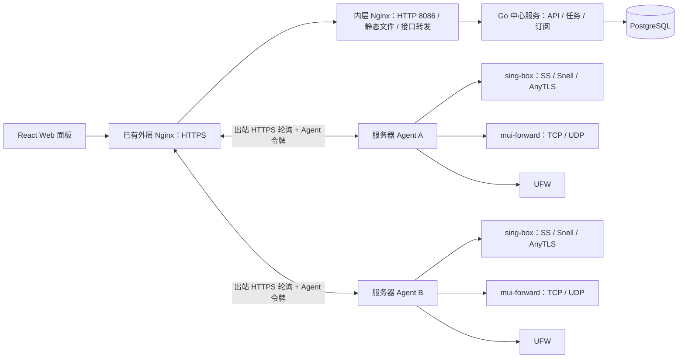

# MUI 多服务器节点管理面板：方案设计

状态：首版实现文档。代码对应 React 面板、Go 中心服务与 Agent、SS/Snell/AnyTLS、节点和服务器流量、订阅及 UFW；真实服务器联调仍需面板域名、测试机和 AnyTLS 证书。

## 1. 目标与默认假设

- 一个管理员在面板中登记多台 Linux 服务器，维护服务器名称、国家和公网地址等档案，并在服务器上创建、编辑、启停、删除节点。
- 首版协议：Shadowsocks（SS）、Snell、AnyTLS，统一由 sing-box 承载。
- 查看每个节点的上行、下行、总流量与时间趋势；查看服务器网络流量、运行状态和可用端口。
- 将选中的节点组成订阅，提供可撤销、可轮换的订阅地址。
- 在面板中管理节点端口及自定义 TCP/UDP 防火墙规则。
- 首版面向单管理员、自有服务器；不包含售卖、支付、多租户和按用户计费。

## 2. 架构

- **面板前端**：React + TypeScript，使用 Vite 构建，由独立 Nginx 托管；浏览器、订阅客户端和 Agent 使用统一的公开 HTTPS 地址。Nginx 将 `/api/`、`/agent/`、`/s/`、`/download/`、`/healthz` 转发给 Go，其余页面和静态文件由 Nginx 提供。前后端使用独立镜像，可单独更新或部署到不同主机；Go 后端不再提供前端页面。
- **中心服务**：Go 实现 API、任务调度和订阅生成；PostgreSQL 存储服务器、节点、订阅、任务、流量采样和审计记录；本地开发可用 SQLite。中心服务负责期望配置，不通过 SSH 持续执行命令。
- **服务器 Agent**：Go 单一二进制，默认以非特权账户运行并主动连接中心服务；按版本化任务安装/管理核心、校验并应用配置、采集统计、操作防火墙、回报健康状态。同一二进制以独立的受限 helper 模式获得必要的本地权限，仅接受预定义的安装、配置写入、systemd 与 UFW 操作；sing-box 以另一个独立的非特权账户（`mui-core`）运行，接触不到 Agent 令牌和 helper 套接字。
- **服务器类型**：入口、线路、中转、落地四种，可多选。落地接入时安装 sing-box；在线中转可按需安装核心、搭建节点并作为链路终点，保留中转类型。纯转发服务器只安装 Agent 和本机权限 helper，Agent 可在没有 sing-box 或转发进程时独立运行、连接面板并管理 UFW。第一条启用的转发规则才创建并启动转发服务，最后一条规则移除后停止并禁用。入口、线路通过面板的核心安装任务添加落地类型，不要求重新接入 Agent。
- **完全离线转发**：Agent 0.6.7 支持 `managementMode=offline` 的入口、线路、中转，防火墙固定手动。面板编排链路和手动转发，导出带 Ed25519 签名、服务器身份和配置版本的完整 JSON；目标机只运行非 root 的 `mui-forward.service`，无需面板、在线 worker/helper、sing-box 或 UFW。`offline install/apply` 本地等待进程确认加载，失败恢复原配置；无需向面板回传文件。面板只记录最近导出版本，离线各跳导出当前配置后可参与订阅，在线各跳与落地仍须正常应用；离线应用结果及连通性由管理员确认。签名、固定公钥/服务器 ID、版本检查阻止篡改、误投和版本回退。迁移 16 删除原离线回执快照表；订阅用量仍由在线落地统计，保留独立 JSON 数组的纯本地管理方式。说明见 `docs/offline-forwarding.md`。
- **链路**：首跳（入口或线路）→ 零到八跳中间跳（中转或线路，每跳可多台组成负载均衡组）→ 落地节点。面板据此在每一跳生成转发规则，整条链路同一端口；中间跳与落地节点只放行上一跳的地址。转发规则支持多个目标，链路转发使用双栈监听和同端口 TCP 健康检查，并按主备或轮询选择。手动纯 UDP 规则默认按套接字错误被动切换及定时重试，只有显式指定 TCP 探测时才检查 TCP。来源未知时禁止公开放行；无链路节点使用 closed 状态移除自动允许规则。
- **代理核心**：每台服务器运行一个受管的 sing-box 实例，配置多个入站来承载 SS、Snell、AnyTLS。固定经过验证的 sing-box 版本；升级前在测试机验证协议兼容性和统计能力。
- **端口转发**：同一个 Agent 二进制以独立 `mui-forward` 账户运行转发服务。中心服务保存规则并随期望配置下发，Agent 管理 systemd、UFW、回滚及累计字节上报。TCP 在转发服务器上建立到目标的新连接；UDP 使用按客户端地址分开的会话。Agent 0.6.7 增加 `network=tcp+udp`，同一逻辑规则展开两个运行时监听，共享原规则 ID 的累计计数；两种协议同时校验冲突和生成 UFW 规则，统一启停、编辑、删除。
- **入口与 TLS**：已有外层 Nginx 终止 TLS，并转发到内层前端 Nginx 的 HTTP 入口，Compose 前端默认发布 `127.0.0.1:8086`，后端发布 `127.0.0.1:8087`，容器内分别监听 8086、8087，不占用宿主机 80/443；宿主机内层 Nginx 示例同样监听 8086，Go 生产监听 8087，PostgreSQL 使用容器可访问的已有实例，生产 Compose 只部署 `mui-web` 和 `mui-service`。Go 通过 `MUI_TRUSTED_PROXIES` 信任内层 Nginx；内层仅采信 `MUI_EDGE_PROXY_CIDR` 指定的外层来源所提供的客户端 IP 和协议，外层覆盖客户端提供的转发头。支持容器 Nginx 和宿主机 Nginx，配置文件位于 `deploy/nginx/`。
- **首次接入**：面板生成一次性安装令牌；管理员在目标机执行安装命令，从面板服务器下载安装脚本及对应架构的 Agent、sing-box 和校验文件。校验通过后登记 Agent 身份，随后由 Agent 主动连接中心服务，目标服务器无需对公网开放控制 API。

## 3. 核心数据模型

| 对象 | 关键字段 | 说明 |
|---|---|---|
| Server | ID、服务器名称、类型（可多选）、国家代码、地区/城市、服务商、标签、备注、公网 IPv4/IPv6、内网地址、订阅用域名、系统/架构、Agent 版本、在线状态 | 一个受管服务器；档案信息与 Agent 上报的运行信息分开保存 |
| Node | ID、Server ID、节点名称、协议、入站 tag、监听地址、端口、TCP/UDP、发布地址覆盖值、是否允许直连、UFW 放行模式与来源、链路来源（面板计算）、状态、配置版本 | 一个可订阅节点；首版每节点独占监听地址、传输协议与端口的组合 |
| NodeTemplate | ID、名称、协议、端口、监听地址、加密/混淆设置、TLS 域名、UFW 放行模式与来源、加密保存的可选密码 / PSK | 可复用的节点配置；不保存服务器或证书引用 |
| NodeSecret | Node ID、加密凭据、证书引用 | PSK、协议密码不以明文入库；TLS 私钥由 Certificate 对象保存 |
| Certificate | ID、名称、域名、证书链、加密私钥、到期时间 | 全局共享，AnyTLS 节点引用；上传时验证证书与私钥匹配 |
| TrafficSample | Node ID、上行/下行累计值、采样时间、sing-box 实例 ID | 用于差值、趋势和重启识别 |
| FirewallRule | Server ID、端口/范围、协议、来源 CIDR、动作、归属、状态 | 节点自动规则与自定义规则分开 |
| ForwardRule | Server ID、TCP/UDP、监听 IP/端口、目标列表（主机/端口）、主备或轮询、所属链路、UFW 来源策略、状态、累计流量 | 手动建的转发独立存在；链路生成的转发随链路变化 |
| Route | ID、名称、首跳服务器、中间跳（服务器组、模式、目标是否走内网、来源模式）、落地节点、落地目标是否走内网、落地来源模式、端口、启用 | 来源模式独立选择 auto/public/internal；面板据此生成逐跳转发和 UFW 规则 |
| Subscription | ID、名称、格式、链路列表、直连节点列表、令牌哈希、启用/到期状态 | 下载时动态生成内容 |
| Operation | ID、目标、期望版本、阶段、结果、错误、发起人 | 节点/防火墙变更的审计与重试依据 |

数据库保存期望状态；Agent 回报实际状态。面板同时展示“期望状态 / 实际状态 / 最近错误”，避免把已保存误报成已生效。

## 4. 关键流程

### 首版协议配置

| 协议 | 必填项与默认值 | 监听与限制 |
|---|---|---|
| SS | 节点名称、端口、加密方式、随机生成的密码；默认 `2022-blake3-aes-128-gcm` | TCP + UDP；只开放 sing-box 当前版本支持且订阅可表达的加密方式 |
| Snell | 节点名称、端口、PSK、ShadowTLS v3 SNI / 握手域名、独立 ShadowTLS 密码；默认 v6，可选 v5、默认无混淆 | TCP；公网 ShadowTLS 入站转发到内部 Snell 入站，v6 使用默认模式；v5 QUIC 代理模式暂不实现 |
| AnyTLS | 节点名称、端口、随机生成的密码、域名、有效 TLS 证书 | TCP；首版要求域名与证书匹配，不自动启用不安全的证书校验选项 |

SS 和 AnyTLS 节点各使用一个入站；Snell 节点使用 ShadowTLS v3 公网入站，通过 `detour` 注入内部 Snell 入站；内层固定监听 `127.0.0.1:snellPort`，节点和模板可指定内层端口，面板及 Agent 一并校验其端口冲突，不开放公网防火墙，使用分开的加密凭据。订阅配置使用节点或链路的原始名称，不附加 ID 后缀，默认使用服务器订阅用域名，否则使用公网 IPv4/IPv6；节点可单独覆盖发布地址。端口冲突按“监听地址 + 传输协议 + 端口”检查，考虑 `0.0.0.0`、`::` 的通配监听和 IPv6 双栈行为，不把 UDP 与 TCP 错判为冲突。

AnyTLS 首版支持上传 PEM 证书链和私钥，面板检查域名、到期时间与密钥匹配。证书到期告警已实现：服务端返回每张证书的 `daysUntilExpiry` / `expiringSoon`（30 天内为真），前端在证书列表展示红色/黄色到期徽章，并在设置页与总览“需要关注”中提示。自动签发与续期作为后续功能；这样首版不依赖 DNS 服务商密钥或 80/443 端口可用性。

### 新建服务器

1. 管理员填写服务器名称、国家、公网 IPv4/IPv6 或订阅用域名；地区/城市、服务商、标签、备注可选。国家使用标准国家代码，由管理员选择和修改，不以 IP 归属查询结果自动覆盖。
2. 面板生成有效期 10 分钟、仅能使用一次的安装令牌和版本固定的 Agent 安装命令。安装脚本及按架构构建的文件通过面板 `/download` 路由公开只读分发，接入令牌作为安装脚本的位置参数传递，不出现在下载 URL 中，也无需设置环境变量。安装包校验摘要后写入 systemd 服务；Agent 安装后回报系统、架构、检测到的网络地址、UFW 状态、sing-box 版本及心跳。
3. 面板标记服务器在线，对比手工填写的公网地址与 Agent 检测结果，并验证订阅用地址、证书域名和时间同步；有差异时提示管理员确认。

### 新建或修改节点

管理员可先维护节点模板，或从现有节点保存模板。新建节点选择服务器和模板后预填名称与协议设置；AnyTLS 按 TLS 域名从统一证书库自动匹配有效证书，也可手动选择覆盖该域名的证书。模板可保存加密的密码 / PSK，Snell 模板还可保存独立的 ShadowTLS 密码；选用模板时新节点使用相应密码，留空则为每个节点独立生成。SS 2022 密钥按加密方式生成 16 或 32 字节随机数并以 Base64 编码，后端保存前再次校验。模板变更不回写已有节点。

1. 按协议呈现必要字段并检查端口占用、同机重复监听、证书/密钥有效性、协议与 sing-box 版本兼容性。
2. 生成候选配置并在 Agent 上运行 sing-box 配置校验；保存旧配置快照。
3. 在防火墙中加入节点所需端口，应用 sing-box 配置，探测监听与进程健康。
4. 先把变更记录为待应用版本；Agent 确认成功后标记为生效并更新订阅内容。失败时恢复旧配置及本次新增的端口规则，保留原生效版本并记录可读错误。
5. 删除节点先停止监听并确认生效，再移除订阅条目和该节点拥有的防火墙规则；任何步骤失败都显示未完成状态并允许重试。保留历史流量和审计记录。

首版每台服务器运行一个受管 sing-box 实例、多个入站；同一节点使用稳定且唯一的入站 tag。变更可能短暂重启 sing-box，界面需提示同机节点的影响范围。

中心服务为每项变更分配操作 ID 和配置版本；Agent 持久化任务结果并拒绝过期配置版本。Agent 主动通过 HTTPS 轮询任务，使用一次性接入后获取的随机 Agent 令牌鉴权；断线后补传流量和结果。

Agent 0.3.0 起支持自更新。面板从本机发布的 `mui-agent` 与 `SHA256SUMS` 核对目标 SHA-256，并下发白名单 `agent.upgrade` 任务；root helper 只从已保存的面板 HTTPS 地址下载同架构 Agent，验证哈希、Go 构建路径与版本命令后替换可执行文件。systemd 延迟重启 Agent/helper，不重启 sing-box。新 Agent 成功回报构建哈希后任务完成；定时守护任务在 4 分钟内未见成功回报时恢复上一个 Agent。旧 Agent 不具备接收自更新任务的能力，需要人工安装一次新版。

Agent 0.4.0 起还支持独立的 `core.upgrade` 任务。面板固定同架构 sing-box 构建哈希；root helper 从面板下载并验证，检查所需构建标签和现有配置，再备份、替换并重启 sing-box。服务或节点监听探测失败时恢复旧二进制并重启旧服务。升级会短暂断开该服务器上的节点连接；未运行且无节点的核心只替换文件，不启动服务。

### 流量统计

- **节点与订阅流量**：启用 sing-box V2Ray API 的 `stats.inbounds` 和 `stats.users`，分别按节点入站 tag 与每个“节点 + 订阅”唯一用户名读取上/下行。所选二进制必须包含 `with_v2ray_api` 构建能力，并仅在本机监听统计 API。Agent 每 30 秒采样；中心服务分别保存节点与订阅的幂等增量和累计值。 传统 SS（如 `aes-256-gcm`）支持订阅分发，但共享节点密码，仅有节点级统计；混合订阅显示部分统计，全为共享节点时显示无法按订阅统计。
- **持久化**：Agent 本地保留最近采样和待上传增量，断线后补传；中心服务以“节点 + 实例 + 采样序号”去重。重启或计数回退时开启新统计段，不产生负流量。
- **口径**：节点统计是代理核心处理的入站字节，不等同于云厂商账单字节。服务器网卡流量按默认外网网卡单独展示。进程崩溃或系统突然断电时，最后一次采样之后的流量可能缺失；首版不承诺计费级精度。累计值单独保存；原始采样默认保留 90 天（`MUI_TRAFFIC_RETENTION_DAYS`，0 为永久保留），过期后自动清理而不影响累计流量。
- **验证门槛**：上线前分别用 SS、Snell、AnyTLS 实测统计接口，覆盖 TCP、UDP、重启和断线补传。若 sing-box 统计接口不可用，面板显示“统计不可用”并告警，不把缺失流量当成零。

### 证书

- 证书统一管理，上传时不选择服务器；AnyTLS 节点通过 Certificate ID 引用，允许跨服务器复用。TLS 域名按证书真实 SAN / 通配符覆盖范围校验，私钥加密保存，仅随引用它的节点配置下发到对应服务器。
- 证书列表显示使用节点数；仍被任意节点引用（包括待删除节点）的证书不能删除。删除服务器不删除证书。后端启动时自动迁移原有服务器绑定，保留证书 ID、证书链、加密私钥与节点引用。

### 订阅

- 订阅对象是“链路与直连节点集合 + 输出格式”；链路条目使用首跳地址和链路端口，协议与凭据来自落地节点；只有开启“允许直连”的节点可以直接加入订阅。新订阅在每个选中节点拥有独立用户凭据，下载时动态生成配置。SS 2022 输出“服务器密钥:用户密钥”，Snell 输出共享 PSK、Snell 本身保持单用户，AnyTLS 输出独立密码。经 ShadowTLS 接入的 Snell 节点改由每条订阅独立的 ShadowTLS 密码鉴权（需要 Agent 0.6.0），流量按 ShadowTLS 用户名归属到订阅；Surge 订阅因此可包含这类 Snell 节点。停用、删除和到期会排队移除用户，离线 Agent 恢复前旧凭据仍可能可用。轮换下载令牌不会轮换登录凭据。订阅配置使用节点或链路的原始名称，不附加 ID 后缀。
- 当前输出：sing-box 出站 JSON 片段、Surge `[Proxy]` 片段，以及 v2rayN 的 Base64 编码分享链接列表。v2rayN 支持 SS 2022 与 AnyTLS 节点及其链路，不支持 Snell / ShadowTLS；AnyTLS 需使用 sing-box 内核。单节点复制功能按协议提供；后续按需求增加 Mihomo 配置。
- 每种输出建立能力表：协议版本、传输、TLS 字段、客户端最低版本。不能表达的节点从该格式中排除，并在面板显示原因；不生成看似有效但不能连接的条目。
- 订阅接口使用高熵随机令牌、HTTPS、限速；可设过期时间。订阅响应禁止公开缓存，不在日志中记录完整 URL 或节点密码。

### 防火墙

- 每台服务器通过 `firewallMode` 选择 `ufw`（默认，含旧记录空值）或 `manual`。Agent 0.6.4 上报 `manualFirewallSupport` 后，已有服务器才可改为手动管理。该模式跳过 UFW 预检查、规则同步、漂移检查、SSH 放行修补及防火墙回滚，仍部署节点、证书和转发；不会启用、关闭或清理现有防火墙。面板拒绝 UFW 初始化、规则增删及接管。模式变更下发完整配置，既有未完成的 UFW 初始化或主机规则删除任务需先完成。
- UFW 托管服务器读取 UFW 状态和规则；若未安装或未启用，节点配置不能应用，面板提供受保护的 UFW 初始化流程。检测到其他正在管理主机防火墙的工具时停止写入并提示管理员处理冲突。手动管理无需 UFW，端口与来源限制由外部管理；“允许直连”仅决定直连订阅资格，不代表主机已限制访问。链路逐跳判断接收方模式，只有 UFW 托管接收方要求上一跳具有明确的来源 IP。
- 初始化 UFW 前要求目标机已安装 UFW；Agent 先通过 `ss -H -lntp` 与活动的 `ssh.socket` / `sshd.socket` 确认 SSH 实际 TCP 监听，将实际端口与 `sshd -T` 中的配置端口一并放行后，再启用 UFW；无法确认实际监听时拒绝初始化。LXC 使用容器内部监听端口，并设置两分钟自动关闭计时器。只有面板确认收到 Agent 回报后才取消计时器。本面板不清空现有 UFW 规则，只修改带面板归属标记的规则。
- 链路目标地址与来源白名单独立选择：`RouteHop.sourceMode` 和 `Route.nodeSourceMode` 支持 auto/public/internal，默认 auto 沿用目标地址类型，public/internal 显式选择上一跳公网/内网 IP，不改变连接目标或绑定出站地址。白名单再按下一跳实际目标的地址族筛选：IPv4 目标仅加入上一跳 IPv4，IPv6 目标仅加入 IPv6；域名目标可能解析到两种地址族。下发前统一规范为单地址 `/32`、`/128` 或规范的 CIDR，避免将不带前缀的来源地址交给 UFW 执行校验。
- 节点默认只允许链路最后一跳访问，无链路时使用 closed 状态移除自动允许规则；开启直连后可放行所有来源或指定最多 32 个 IP/CIDR，仅为这些来源创建 TCP/UDP 入站规则；指定来源模式要求 UFW 默认入站策略为 deny/reject。手动管理模式不创建节点自动规则。删除节点只删除它拥有且未被其他节点引用的规则。自定义规则支持端口/范围、协议、单个来源 IP/CIDR、允许/拒绝及备注。
- 默认保护当前 SSH 管理端口和 Agent 的出站控制连接；危险变更须先验证再应用，并设置自动回滚计时器。界面显示任务状态和失败原因；规则差异预览属于后续增强。
- 端口转发新建规则默认 `restricted`（仅放行指定来源），公开放行需管理员在表单中显式选择并在提交时再次确认；UFW 未启用或检测到其他防火墙工具时转发页展示 error 横幅。UDP 会话以客户端地址为键、无认证，源地址可被伪造并可能被用于反射，属于 UDP 协议固有风险，不要把转发端口当作认证边界。
- 云厂商安全组不属于主机防火墙：若端口在主机侧已放行但公网仍不通，明确提示检查云安全组。

## 5. 面板页面

面板共 14 个页面（侧栏 11 个顶级入口，其中“客户端管理”“操作记录”为分组）：

1. **总览**：服务器在线数、节点状态、今日/本月流量、最近失败任务。
2. **服务器**：列表展示名称、国家、地址、服务商、在线状态和节点数；详情可编辑地区/城市、标签、备注，查看 sing-box 版本、默认网卡流量与心跳；CPU/内存和 Agent 日志属于后续增强。
3. **节点**：按服务器/协议筛选，新建、编辑、启停、删除、流量明细和复制分享配置；复杂统计图表属于后续增强。
4. **节点模板**：保存常用协议/端口/连接参数及可选密码，新建节点时选用带入；UFW 策略不随模板保存。
5. **证书**：上传 AnyTLS 证书链与私钥（私钥加密保存），展示到期时间与到期告警徽章。
6. **防火墙**：现有规则、节点自动规则、自定义规则、变更历史。
7. **端口转发**：TCP/UDP 监听与目标、累计流量、放行来源；新建规则默认仅放行指定来源，需显式确认才公开。
8. **订阅**：创建节点集合、选择格式、预览、复制链接、轮换/禁用令牌。
9. **客户**（客户端管理分组）：客户档案与关联订阅、流量汇总。
10. **订阅访问记录**（客户端管理分组）：成功下载订阅的来源 IP、客户与订阅。
11. **节点连接 IP**（客户端管理分组）：Agent 采样的活跃连接来源 IP，仅作观测，不能称为完整连接日志。
12. **任务记录**（操作记录分组）：任务进度、失败原因、重试、配置回滚记录。
13. **审计日志**（操作记录分组）：管理员在面板上做过的改动。
14. **设置**：管理员密码、TOTP 双因素认证、证书到期提示。

## 6. 安全和运维边界

- 面板登录至少支持管理员账户、强密码和 TOTP；所有控制接口鉴权，敏感操作留审计。
- `MUI_PUBLIC_URL` 可用逗号配置多个公开 URL，第一个为默认；登录 Origin 校验接受这些地址，Cookie 保持当前域名独立。安装、下载及订阅链接只从配置列表中选择当前访问地址，无法识别时使用默认，不采用任意 Host 或 X-Forwarded-Host。各域名由外层 Nginx 配置证书、保留 Host 并转发到同一后端。
- 中心与 Agent 使用 HTTPS 加高熵令牌身份认证；一次性接入令牌短期有效，Agent 凭据可撤销和轮换。
- Agent 不提供任意 shell 执行 API；只接受结构化、白名单操作。配置写入临时文件并原子替换；服务和防火墙操作限制路径与参数。
- 节点密钥加密存储，密钥材料不进入常规日志；数据库使用已有 PostgreSQL 实例的备份策略，生产 Compose 不部署数据库或备份服务，`MUI_SECRET` 须与数据库备份分开、离线保存；升级可回退。
- 支持 Ubuntu 22.04/24.04/26.04、Debian 11/12/13（systemd），以及 Alpine 3.19+（OpenRC），amd64/arm64；UFW 托管另需安装 UFW。Debian 11 已结束官方 LTS 安全更新，部署时应升级系统或安排 Extended LTS。不满足系统条件的服务器在接入时报告“不支持”，避免半安装状态。中心服务以容器方式部署，数据库迁移随版本执行；Agent、转发和 sing-box 按主机服务管理器使用 systemd 或 OpenRC，延时回滚任务独立于 Agent 生命周期。512 MiB 环境自动设置各进程的 Go 软内存目标，保留权限隔离。

## 7. 实施顺序与验收

| 阶段 | 交付 | 验收要点 |
|---|---|---|
| 1. 基础管理 | 登录、服务器接入、Agent 心跳、任务与审计 | 两台服务器可独立接入和离线恢复 |
| 2. 节点 | SS、Snell、AnyTLS 的增删改停 | 每种协议能连接；失败能回滚；无端口冲突 |
| 3. 统计 | 节点与服务器流量、趋势、断线补传 | 测试流量可见；重启后无负值/重复累计 |
| 4. 订阅 | sing-box、Surge、v2rayN 格式及令牌管理 | 客户端导入可连接；轮换后旧链接失效 |
| 5. 防火墙 | 自动端口规则、自定义规则、保护与回滚 | 能放行/关闭端口；SSH 和 Agent 管理连接不中断 |

## 8. 开发基线与外部准备

- **当前范围**：Ubuntu 22.04/24.04/26.04、Debian 11/12/13、Alpine 3.19+；SS、Snell v5/v6、AnyTLS；按节点及订阅用户统计；sing-box、Surge 与 v2rayN 订阅；仅管理 UFW。流量限额、自动证书签发和其他订阅格式尚未实现。客户管理与 IP 观测见第 10 节。
- **仓库组织**：`web/` 为 React + TypeScript 前端；`cmd/server/` 与 `cmd/agent/` 为两个 Go 入口；`internal/` 保存后端与 Agent 的私有实现，其中 `internal/shared/types.go` 是面板与 Agent 之间消息契约的唯一定义；`deploy/` 保存中心服务和 Agent 的部署文件。
- **开始编码**：可用本地 PostgreSQL、模拟 Agent 和测试证书完成前后端、数据模型与任务流程；真实服务器环境不是开始编码的前置条件。
- **联调和上线前需提供**：面板 HTTPS 域名、至少一台测试服务器、用于 AnyTLS 的域名和证书，以及目标客户端版本。真实环境的信息只影响联调与部署，不阻止按本方案开始开发。

- 端口转发进程（`mui-agent forward`）按规则各自持有监听、连接和计数器，收到 SIGHUP 后就地重新加载规则文件：监听地址和目标都没变的规则原样保留，其余的停掉重建；加载成功后才更新就绪文件，helper 据此判断结果。加载失败时先热重载旧配置，只有恢复失败才重启进程。域名首次解析和定期刷新均在后台运行，不阻塞监听；TCP 走内核 splice，UDP 目标地址和域名解析都不在收包路径上。

## 9. 参考依据

- sing-box [SS 入站](https://sing-box.sagernet.org/configuration/inbound/shadowsocks/)、[AnyTLS 入站](https://sing-box.sagernet.org/configuration/inbound/anytls/)、[Snell 入站](https://sing-box.sagernet.org/configuration/inbound/snell/)、[ShadowTLS 入站](https://sing-box.sagernet.org/configuration/inbound/shadowtls/) 与 [V2Ray API 统计](https://sing-box.sagernet.org/configuration/experimental/v2ray-api/)；[Surge Shadow TLS 配置](https://manual.nssurge.com/policies/tls.html)。

## 10. 客户管理与 IP 观测

- 一个客户可关联多条订阅；订阅保留各自的格式、节点集合、到期时间和令牌。现有订阅升级后先保持“未分配客户”，由管理员归属。
- 面板在成功响应 `/s/{token}` 时记录订阅 ID、可信客户端 IP 和时间。只有请求来自 `MUI_TRUSTED_PROXIES` 配置的反向代理时才读取转发头，否则使用直接连接地址。该记录能准确回答“哪个 IP 在什么时候拉取了哪条订阅”，但订阅链接可能被转发，IP 也可能是 NAT 或代理出口。
- Agent 可以从仅监听本机的 sing-box Clash API 连接快照读取节点入站标签和来源 IP，定期回报。快照只能观测采样时仍活跃的连接，短连接可能漏掉；这类记录应标为“节点连接 IP”，不能称为完整连接日志。实测 sing-box 1.14.2 的连接快照不包含经 ShadowTLS 转入 Snell 的连接，这类节点目前没有连接 IP 记录。
- Agent 0.5.0 上报多用户能力后，面板为支持多用户的节点与订阅组合生成独立登录密钥，并在配置应用成功后下发；用户流量按订阅标识回报，客户页汇总当前关联的订阅。Agent 0.6.0 起，经 ShadowTLS 接入的 Snell 节点改由每条订阅的 ShadowTLS 密码鉴权、Snell 保持单用户，流量按 ShadowTLS 用户名归属到订阅；Surge 订阅因此可包含这类 Snell 节点，AnyTLS 在 sing-box 与 v2rayN 订阅中提供。面板记录每台服务器最近一次成功应用时各节点的配置指纹和已部署的订阅，订阅下载逐节点比对，只下发已生效的节点，不再因为同一服务器或其他服务器上的未完成变更而整体拒绝。连接快照仍只提供节点来源 IP，不能仅凭 IP 推断使用者。
- 两类 IP 记录分开展示，默认只保留必要的 IP、时间、订阅/节点标识，按保留期限清理；不保存访问目标地址。停用订阅仅阻止后续拉取，已经发出的节点凭据仍可使用。

## SOCKS5 与 Agent 控制连接

SOCKS5 TCP 入站强制用户名密码，服务器必须为 UFW 托管且已启用；Agent 校验禁止手动管理模式部署 SOCKS5。模板保存用户名及加密密码；订阅生成独立 SOCKS 用户，统计按用户名归属。入口档案仅存代理节点 ID 和是否走内网，签名任务通过加密状态存储下发解析后的代理凭据。安装 curl、Agent HTTP 客户端及升级下载共用所选代理；面板 DNS 交给 SOCKS5。现有入口切换前校验新连接，原子更新 root 所有的连接配置；确认应用前保留旧代理依赖，避免维护操作导致断联。具体操作与 TCP 范围见 docs/agent-socks5.md。

Snell v5 服务端输出 `obfs_mode`，v6 服务端和客户端输出 `mode: default` 并省略旧混淆字段。Agent 0.6.11 修复实际核心 JSON 解码错误；旧版本不能领取包含 v6 的应用任务，升级任务仍可正常领取。回归测试用实际发布核心校验不同版本、ShadowTLS、多用户及历史混淆设置的服务端与订阅配置。
